<!-- ═══════════════════════════ HEADER ═══════════════════════════ -->

  

  

  
  
  <!-- TODO (CV): replace CV_LINK with the link to your resume PDF -->
  
  

  

---

<!-- ═══════════════════════════ ABOUT ═══════════════════════════ -->
##  About Me

I'm **Razane**, a final-year cybersecurity engineering student at **EMSI Marrakech** who loves understanding how systems break — and proving how they can be secured.

My path is built around **security auditing and GRC**: looking at an infrastructure with a critical eye, identifying the risks, and turning technical findings into clear, actionable recommendations. I put this mindset into practice during my **network security internship**, where I designed a segmented architecture protected by a **FortiGate** firewall, and I keep sharpening it in isolated labs with **Kali Linux, Wireshark and Nmap**.

I'm also fascinated by the place where **AI meets security** — from detecting malicious network traffic to privacy-preserving machine learning.

 

> 🎯 **Next step:** a paid **PFE internship in cybersecurity audit / GRC**, where I can learn from experienced professionals and bring real value from day one.

<table>
<tr>
<td>🔐 <b>Focus</b></td><td>Security Audit & GRC · Network Security · AI for Cybersecurity</td>
</tr>
<tr>
<td>🔭 <b>Exploring</b></td><td>Digital Forensics · SOC · Cloud Security · Cryptography · Blockchain</td>
</tr>
<tr>
<td>🌍 <b>Languages</b></td><td>Arabic (native) · French (fluent) · English (intermediate) · German (A2)</td>
</tr>
<tr>
<td>💬 <b>Motto</b></td><td><i>"Security is not a product, but a process."</i></td>
</tr>
</table>

---

<!-- ═══════════════════════════ EXPERIENCE ═══════════════════════════ -->
##  Experience

<table>
<tr>
<td width="50%" valign="top">

### 🔥 Network Security Intern
**SRM Marrakech-Safi** · `Jul 2026 – Aug 2026`

- Designed and deployed a **segmented network architecture** with a **FortiGate** firewall
- Configured security policies and inter-zone filtering rules
- Documented the architecture

</td>
<td width="50%" valign="top">

### 💻 Development Intern
**SRM Marrakech-Safi** · `Jul 2025`

- Set up a **Moodle** e-learning platform
- Configured courses, user accounts, roles and access rights

</td>
</tr>
</table>

---

<!-- ═══════════════════════════ PROJECTS ═══════════════════════════ -->
##  Featured Projects

<!-- TODO (PROJECTS): fill one card per public, documented repository.
     Status: ✅ Completed  or  🚧 In progress. Delete unused cards. -->

<table>
<tr>
<td width="50%" valign="top">

### 🛡️ [Project name](https://github.com/Razane-Zouine/REPO)
One sentence: the problem and the result.

`Tech` `Tech` `Tech`  
**Status:** ✅ Completed

</td>
<td width="50%" valign="top">

### 🌐 [Project name](https://github.com/Razane-Zouine/REPO)
One sentence: the problem and the result.

`Tech` `Tech` `Tech`  
**Status:** 🚧 In progress

</td>
</tr>
<tr>
<td width="50%" valign="top">

### 🧠 [Project name](https://github.com/Razane-Zouine/REPO)
One sentence: the problem and the result.

`Tech` `Tech` `Tech`  
**Status:** ✅ Completed

</td>
<td width="50%" valign="top">

### 🔍 [Project name](https://github.com/Razane-Zouine/REPO)
One sentence: the problem and the result.

`Tech` `Tech` `Tech`  
**Status:** 🚧 In progress

</td>
</tr>
</table>

---

<!-- ═══════════════════════════ LABS ═══════════════════════════ -->
##  Cybersecurity Labs

<!-- TODO (LABS): one row per lab once its repository is public. -->

| Lab | Scope | Tools |
|---|---|---|
| 🔥 [Lab name](https://github.com/Razane-Zouine/REPO) | What was built and tested | `Tool` `Tool` |
| 🐉 [Lab name](https://github.com/Razane-Zouine/REPO) | What was built and tested | `Tool` `Tool` |
| 🔎 [Lab name](https://github.com/Razane-Zouine/REPO) | What was built and tested | `Tool` `Tool` |

---

<!-- ═══════════════════════════ SKILLS ═══════════════════════════ -->
##  Tech Stack

<b>🔐 Security & Networking</b>

  
  
  
  
  
  
  

<b>💻 Languages & Frameworks</b>

  <!-- skillicons: theme adapts to light / dark mode -->
  <picture>
    <source media="(prefers-color-scheme: dark)" srcset="https://skillicons.dev/icons?i=python,c,java,cs,react,flutter,mysql,solidity,pytorch,linux,git,github&perline=12&theme=dark"/>
    
  </picture>

<b>📚 Currently learning:</b> Security Audit & GRC · Digital Forensics · Cloud Security · Cryptography

---

<!-- ═══════════════════════════ DASHBOARD (light / dark) ═══════════════════════════ -->
##  GitHub Dashboard

  <picture>
    <source media="(prefers-color-scheme: dark)" srcset="https://github-readme-stats.vercel.app/api?username=Razane-Zouine&show_icons=true&hide_border=true&count_private=true&rank_icon=github&bg_color=0D1117&title_color=58A6FF&icon_color=1F6FEB&text_color=C9D1D9"/>
    
  </picture>
  <picture>
    <source media="(prefers-color-scheme: dark)" srcset="https://github-readme-stats.vercel.app/api/top-langs/?username=Razane-Zouine&layout=compact&hide_border=true&langs_count=6&bg_color=0D1117&title_color=58A6FF&text_color=C9D1D9"/>
    
  </picture>

  <picture>
    <source media="(prefers-color-scheme: dark)" srcset="https://streak-stats.demolab.com?user=Razane-Zouine&hide_border=true&background=0D1117&ring=1F6FEB&fire=FFA657&currStreakLabel=58A6FF&sideLabels=C9D1D9&currStreakNum=FFFFFF&sideNums=FFFFFF&dates=8B949E&stroke=30363D"/>
    
  </picture>

<!-- Snake animation: generated every day by .github/workflows/snake.yml -->

  <picture>
    <source media="(prefers-color-scheme: dark)" srcset="https://raw.githubusercontent.com/Razane-Zouine/Razane-Zouine/output/github-snake-dark.svg"/>
    
  </picture>

---

<!-- ═══════════════════════════ RECENT ACTIVITY (auto-updated) ═══════════════════════════ -->
##  Recent Activity

<!-- Filled automatically by .github/workflows/activity.yml — do not edit between the two markers -->
<!--START_SECTION:activity-->
<!--END_SECTION:activity-->

---

<!-- ═══════════════════════════ EDUCATION & CERTS ═══════════════════════════ -->
<table>
<tr>
<td width="50%" valign="top">

### 🎓 Education
**Engineering Degree — Computer Science & Networks**  
*Cybersecurity track*  
EMSI Marrakech · `Expected 2027` <!-- TODO: check the year -->

</td>
<td width="50%" valign="top">

### 📜 Certifications
<!-- TODO (CERTIFICATIONS): only certificates actually obtained, with a verification link -->
- [Certificate name](VERIFICATION_LINK) · Issuer · Year

</td>
</tr>
</table>

---

<!-- ═══════════════════════════ FOOTER ═══════════════════════════ -->

  

  

